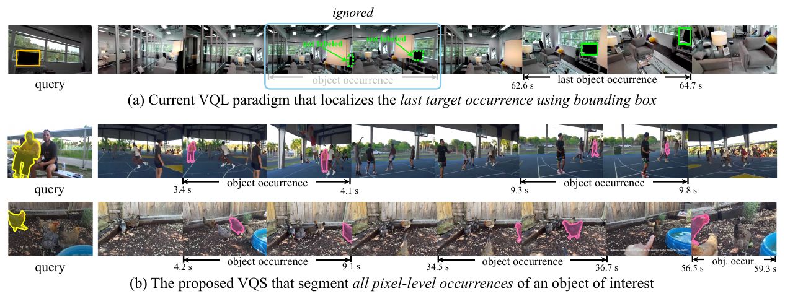
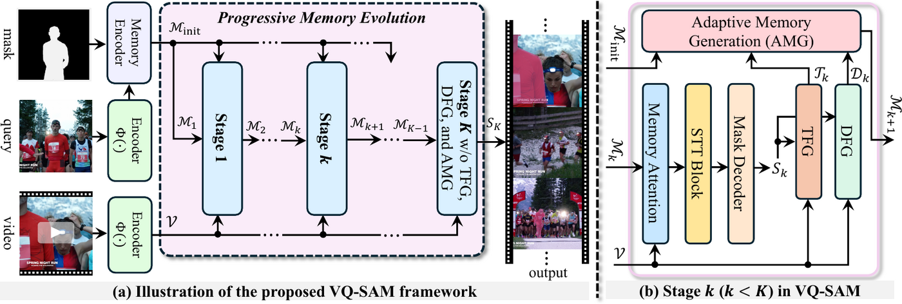
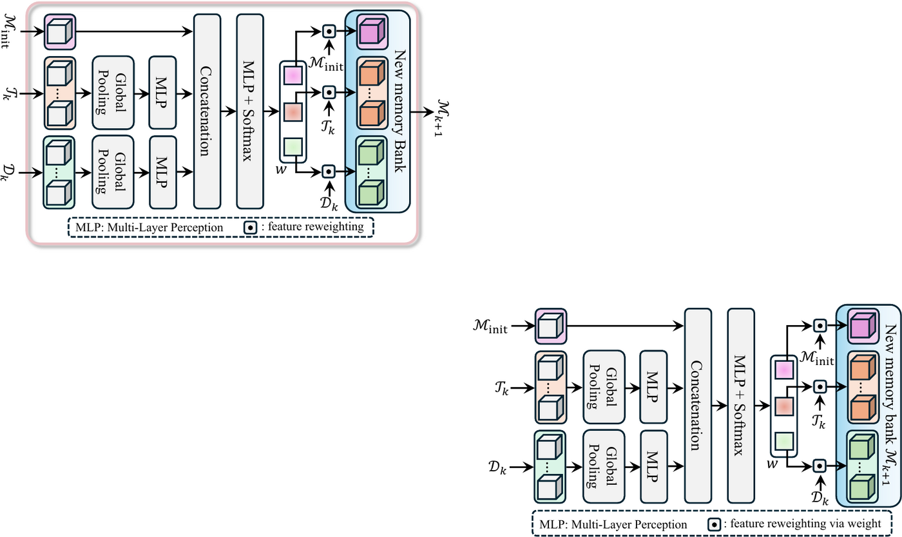

<div align="center">

# Towards Visual Query Segmentation in the Wild

**NeurIPS 2026**

[](https://arxiv.org/pdf/2603.08898)
[](https://huggingface.co/datasets/bf0820/VQS-4K)
[](https://huggingface.co/bf0820/VQ-SAM)
[](LICENSE)

Bing Fan\*, Minghao Li\*, Hanzhi Zhang\*, Shaohua Dong, Naga Prudhvi Mareedu,<br>
Xiaoqiong Liu, Weishi Shi, Yunhe Feng, Yan Huang, Heng Fan†

University of North Texas <br> <sub>\*Equal contribution &nbsp; †Corresponding author</sub>



</div>

## The task

Given an untrimmed video and a **visual query** — one image plus a mask of the target, taken
from **outside** that video — segment the object in **every frame where it appears**, and
nothing where it doesn't.

|  | Reference comes from | Returns |
|---|---|---|
| VOS | the video's own first frame | masks |
| VQL | an external image | one box, last appearance only |
| **VQS** | **an external image** | **masks, all appearances** |

**VQS-4K** — 4,111 videos · 1.3M frames · 222 categories · [on Hugging Face](https://huggingface.co/datasets/bf0820/VQS-4K)
<br>**VQ-SAM** — SAM 2 + spatio-temporal transformer + adaptive memory generation (this repo)

## Results on VQS-4K test

| Method | mSTIoU | mSTIoU₅₀ | mSTIoU₇₅ | mTIoU | mTIoU₅₀ | mTIoU₇₅ | Rec | Succ | FPS |
|---|---|---|---|---|---|---|---|---|---|
| SAM 2 <sub>ICLR'25</sub> | 12.9 | 10.6 | 5.2 | 13.0 | 8.3 | 4.6 | 26.7 | 26.3 | 22 |
| SAM 3 <sub>ICLR'26</sub> | 13.3 | 10.9 | 5.4 | 14.1 | 9.5 | 5.2 | 27.7 | 26.6 | 15 |
| SAM2Long <sub>ICCV'25</sub> | 18.6 | 16.5 | 8.2 | 24.4 | 20.6 | 11.2 | 38.6 | 32.5 | 19 |
| REN <sub>NeurIPS'25</sub> | 16.8 | 17.7 | 8.9 | 23.6 | 19.8 | 9.5 | 34.8 | 30.5 | 12 |
| **VQ-SAM (ours)** | **26.0** | **23.8** | **12.7** | **29.6** | **26.8** | **14.4** | **43.6** | **42.1** | 29 |

<details><summary>All 10 compared methods</summary>

| Method | mSTIoU | mSTIoU₅₀ | mSTIoU₇₅ | mTIoU | mTIoU₅₀ | mTIoU₇₅ | Rec | Succ | FPS |
|---|---|---|---|---|---|---|---|---|---|
| Cutie-b <sub>CVPR'24</sub> | 18.5 | 16.5 | 8.2 | 21.0 | 16.9 | 9.2 | 38.4 | 32.3 | 36 |
| OASIS <sub>ICCV'25</sub> | 15.8 | 13.6 | 6.7 | 21.3 | 17.4 | 9.5 | 34.3 | 29.4 | 48 |
| LOMM <sub>ICCV'25</sub> | 12.5 | 10.2 | 5.0 | 12.7 | 7.9 | 4.3 | 26.1 | 25.8 | 10 |
| SAM 2 <sub>ICLR'25</sub> | 12.9 | 10.6 | 5.2 | 13.0 | 8.3 | 4.6 | 26.7 | 26.3 | 22 |
| SAM2.1++ <sub>CVPR'25</sub> | 12.5 | 10.2 | 5.1 | 14.6 | 10.0 | 5.5 | 28.8 | 25.8 | 16 |
| SAM2Long <sub>ICCV'25</sub> | 18.6 | 16.5 | 8.2 | 24.4 | 20.6 | 11.2 | 38.6 | 32.5 | 19 |
| SAM 3 <sub>ICLR'26</sub> | 13.3 | 10.9 | 5.4 | 14.1 | 9.5 | 5.2 | 27.7 | 26.6 | 15 |
| VQLoC <sub>NeurIPS'23</sub> | 10.1 | 12.5 | 6.3 | 21.5 | 17.5 | 8.4 | 31.7 | 23.2 | 36 |
| PRVQL <sub>ICCV'25</sub> | 13.6 | 14.4 | 7.1 | 22.1 | 18.4 | 8.7 | 32.6 | 26.9 | 30 |
| REN <sub>NeurIPS'25</sub> | 16.8 | 17.7 | 8.9 | 23.6 | 19.8 | 9.5 | 34.8 | 30.5 | 12 |
| **VQ-SAM (ours)** | **26.0** | **23.8** | **12.7** | **29.6** | **26.8** | **14.4** | **43.6** | **42.1** | 29 |

</details>

## Quick start

```bash
# 1. install  (verified: Python 3.10.13, torch 2.5.1+cu124, 4x RTX A6000)
conda create -y -n vqsam python=3.10.13 && conda activate vqsam
pip install --index-url https://download.pytorch.org/whl/cu124 \
    torch==2.5.1 torchvision==0.20.1 torchaudio==2.5.1
pip install -r requirements.txt && pip install -e .

# 2. data + weights
python -c "from huggingface_hub import snapshot_download; \
  snapshot_download('bf0820/VQS-4K', repo_type='dataset', local_dir='data/VQS-4K')"
python -c "from huggingface_hub import hf_hub_download; \
  hf_hub_download('bf0820/VQ-SAM', 'vqsam_hiera_bplus.pt', local_dir='checkpoints')"

# 3. inference + evaluation
python tools/test_video_segmentation.py \
  --sam2_cfg sam2/configs/sam2.1_training/sam2.1_hiera_b+_DAM_AdaptiveGate_Jan28.yaml \
  --sam2_checkpoint checkpoints/vqsam_hiera_bplus.pt \
  --base_video_dir ./data/VQS-4K/images --input_mask_dir ./data/VQS-4K/masks \
  --video_list_file ./splits/test_t-IoU.txt \
  --output_mask_dir ./outputs/predictions --num_frames_per_segment 8

bash eval/scripts/run_metrics.sh --gt-folder ./data/VQS-4K/masks \
  --pred-folder ./outputs/predictions --video-list ./splits/test_t-IoU.txt \
  --output results.json
```

> [!IMPORTANT]
> Run everything from the repository root. Scripts in `tools/` and `training/` put their own
> directory on `sys.path`, so with another `sam2` installed the import can silently resolve to
> it. Check with `python -c "import sam2; print(sam2.__file__)"`; if it points elsewhere,
> prefix commands with `PYTHONPATH=$(pwd)`.

The dataset ships **one tar per sequence** — unpack them in place to rebuild the tree.
Frame `00000` is the query, not part of the video. Masks are sparse: no mask file means the
object is **absent**, and an empty prediction is correct there. See the
[dataset card](https://huggingface.co/datasets/bf0820/VQS-4K) for details.

## Train

```bash
python training/train.py \
  -c configs/sam2.1_training/sam2.1_hiera_b+_DAM_AdaptiveGate_Jan28.yaml \
  --use-cluster 0 --num-gpus 4
```

Hydra resolves `-c` inside the `sam2` package, so the path is `configs/...`, not
`sam2/configs/...`. Data paths live in the config's `dataset:` block and default to
`./data/VQS-4K`. Outputs go to `sam2_logs/<experiment>/`. Also fetch the SAM 2.1
initialisation with `cd checkpoints && ./download_ckpts.sh`.

<details><summary>Ablation configs</summary>

| Config | Ablation |
|---|---|
| `sam2.1_hiera_b+_DAM_AdaptiveGate_Jan28.yaml` | **main model** |
| `..._DAM_AdaptiveGate_DRM2_Jan31.yaml` · `..._DRM3_Jan31.yaml` | distractor memory slots = 2 · 3 |
| `..._DAM_AdaptiveGate_RAM0_Feb8.yaml` · `..._RAM1_Feb8.yaml` · `..._RAM4_Feb6.yaml` | recent memory slots = 0 · 1 · 4 |
| `..._DAM_Gate_QualityWeight_Jan15.yaml` | quality-weighted RAM, 8 frames/segment |
| `..._Jan15_nf12.yaml` · `..._Jan15_nf16.yaml` | 12 · 16 frames per segment |

For `nf16`, set `spatio_temporal_transformer.max_temporal_pos_frames >= scratch.num_frames - 1`
and enable `memory_attention.use_activation_checkpointing`. The inference segment length must
match the training clip length. `configs_repro/` holds the fully resolved configs from the
reported runs.

</details>

## Method

<div align="center"></div>

VQ-SAM keeps a query memory from the visual query and evolves it over `K` stages, mixing in
target-specific and background-distractor cues drawn from the video itself. The adaptive memory
generation module weights those cues per frame:

<div align="center"></div>

## Repository layout

```
sam2/         model code — modeling/spatio_temporal_transformer.py (STTB)
              and modeling/memory_attention.py (AMG) are ours, plus training configs
training/     training loop, VOS dataset/sampler, losses
tools/        inference, multi-GPU inference, visualisation, FPS benchmark
eval/         official metrics (mSTIoU, mTIoU, Rec, Succ)
splits/       both official split protocols
docs/         design notes, train/test guides, environment setup
```

<details><summary>A note on metrics</summary>

The two split protocols (`*_t-IoU.txt` and `*_t-IoU_by_class.txt`) are **alternatives** that
each cover all 4,111 sequences — not nested subsets — so always state which one you used.

`Rec` is the percentage of ground-truth frames with mask IoU above 0.5, counted over **every**
GT frame: a frame the method skipped is a miss, not an excluded sample. `Succ` is measured at
IoU 0.2. Neither aggregates across thresholds. Run on the VQ-SAM predictions, this code
reproduces all eight columns of the table above — see
[`eval/METRICS.md`](eval/METRICS.md) for the full mapping from script keys to paper names.

</details>

## Citation

```bibtex
@inproceedings{fan2026vqs,
  title     = {Towards Visual Query Segmentation in the Wild},
  author    = {Fan, Bing and Li, Minghao and Zhang, Hanzhi and Dong, Shaohua and
               Mareedu, Naga Prudhvi and Liu, Xiaoqiong and Shi, Weishi and
               Feng, Yunhe and Huang, Yan and Fan, Heng},
  booktitle = {Advances in Neural Information Processing Systems},
  year      = {2026}
}
```

Built on [SAM 2](https://github.com/facebookresearch/sam2). Metrics follow the Ego4D VQ2D
protocol. We thank the annotators and volunteers who inspected and refined VQS-4K.
